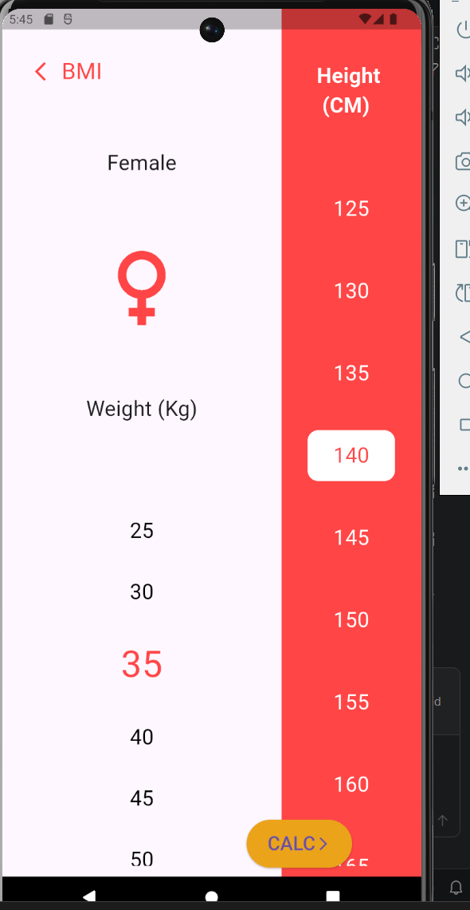
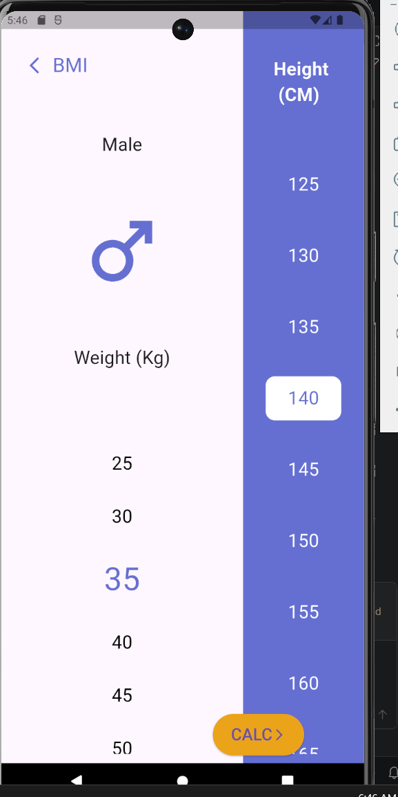
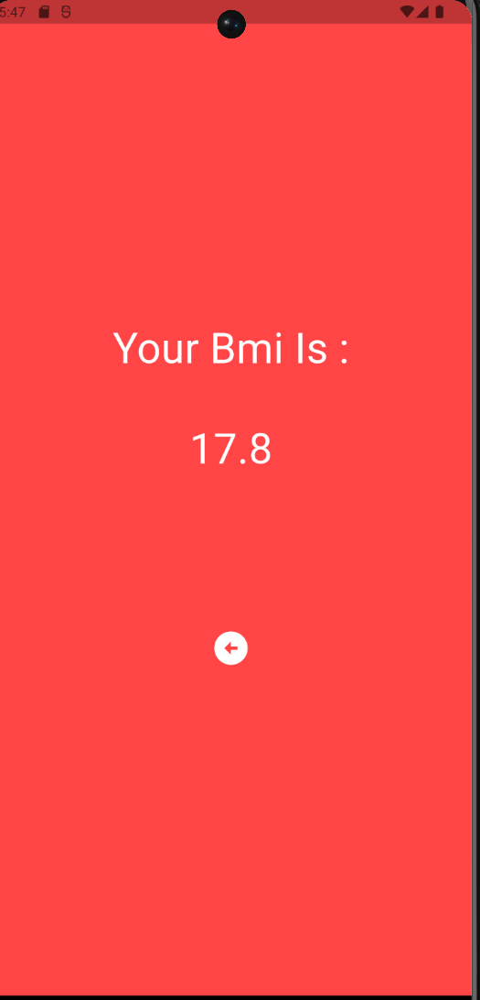

# BMI Calculator App 📱

A modern and responsive BMI (Body Mass Index) Calculator mobile application built with **Flutter**. The app allows users to select their gender, input their weight, height, and age, and instantly calculates and displays their BMI result along with their health status.

---

## 🚀 Features

* **Gender Selection:** Interactive home screen allowing users to choose between Male and Female profiles with dynamic UI styling.
* **Input Measurements:** Easily adjust and input weight, height, and age using customized widgets.
* **BMI Calculation:** Computes the Body Mass Index based on user inputs.
* **Result Display:** Displays the calculated BMI value alongside a specific health status condition (e.g., Underweight, Normal, Overweight).
* **Clean UI/UX:** Designed with a clean, user-friendly interface and smooth navigation between screens.

---
Homepage | Female Screen |
| :---: | :---: |
|  |  |

| Male Screen | Result Screen |
| :---: | :---: |
|  |  |

---

## 🛠️ Tech Stack

* **Framework:** Flutter (Dart)
* **Architecture / State Management:** Clean and structured widget state management.

---
